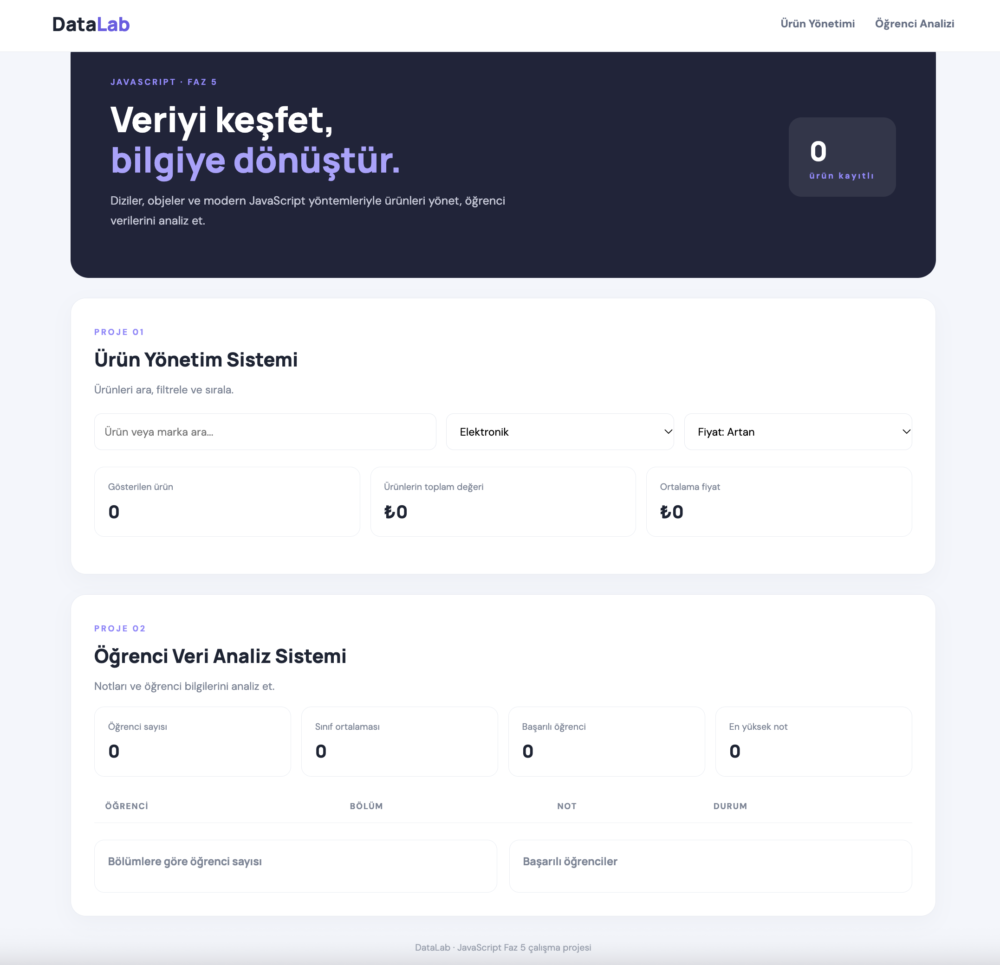

# DataLab – JavaScript Veri İşleme Projeleri

JavaScript Faz 5 kapsamında diziler, objeler ve veri işleme yöntemlerini uygulamalı pekiştirmek için hazırlanmış iki projelik çalışma.

## Proje önizlemesi

## Projeler

### 1. Ürün Yönetim Sistemi

Ürünleri listeleme, arama, kategoriye göre filtreleme, fiyata göre sıralama ve fiyat istatistiklerini hesaplama.

### 2. Öğrenci Veri Analiz Sistemi

Öğrenci notlarını analiz etme, başarı durumunu belirleme, sınıf ortalamasını ve bölüm dağılımını hesaplama.

## Öğrenilecek konular

- Object ve Array yapıları, nested objects, destructuring
- `map()`, `filter()`, `reduce()`, `forEach()`
- `find()`, `some()`, `every()`, `sort()`
- Spread/rest, Set, Map ve JSON
- String, Number, Math, Date ve Regex
- Immutability ve veri dönüştürme

## Teknolojiler

HTML5 · CSS3 · Vanilla JavaScript

## Çalıştırma

1. Projeyi bilgisayarına indir.
2. Klasörü VS Code ile aç.
3. `index.html` dosyasını Live Server ile çalıştır.
4. Console sekmesinden hataları incele.

## Görev dosyaları

- `GOREV.md`: Yapılacak görevler, testler ve bonus çalışmalar.
- `GOREV-KOD-OKUMA.md`: Kod analizi ve metot seçimi soruları.

> Çözüm dosyası eğitmen tarafından saklanmalıdır. Önce hataları kendin bul, nedenlerini açıkla ve ardından düzeltmelerini test et.
